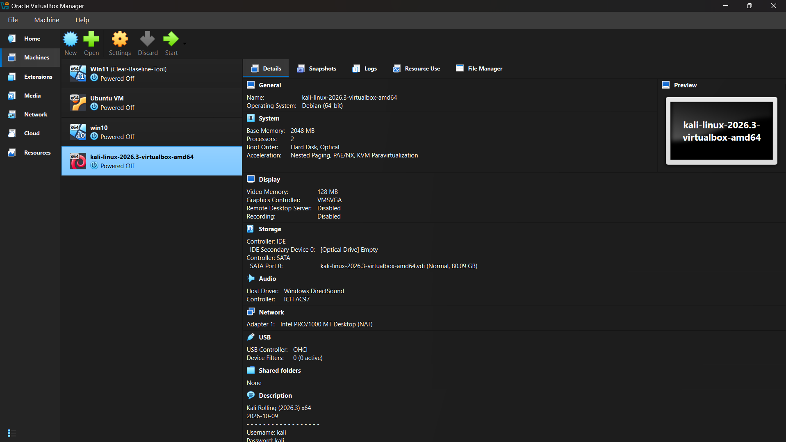
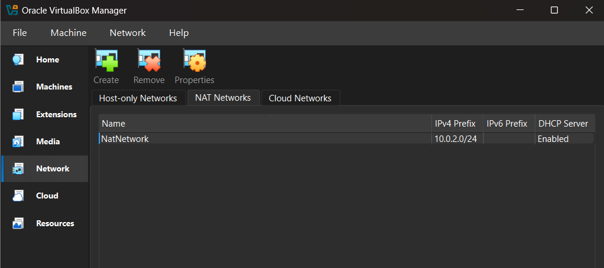
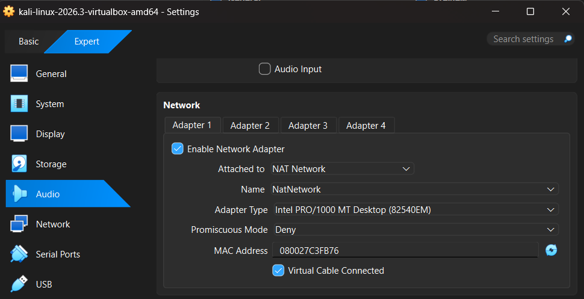
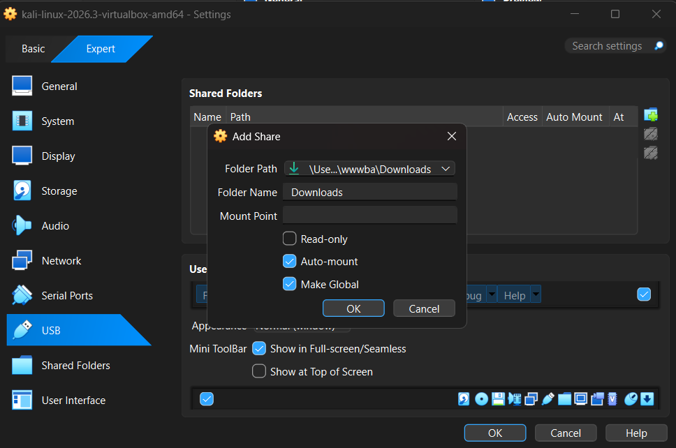
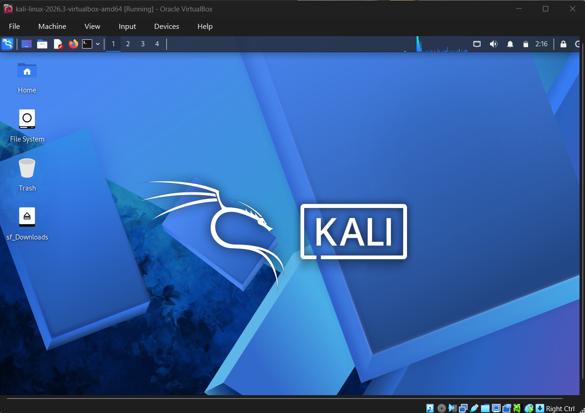
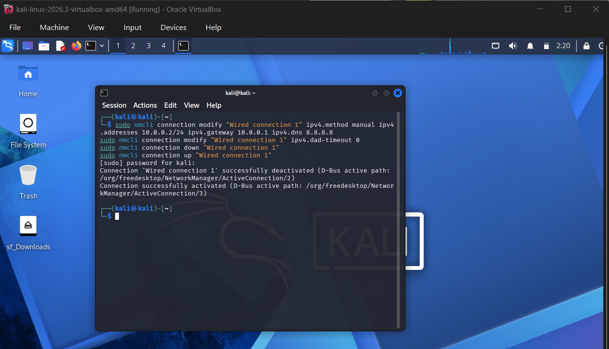
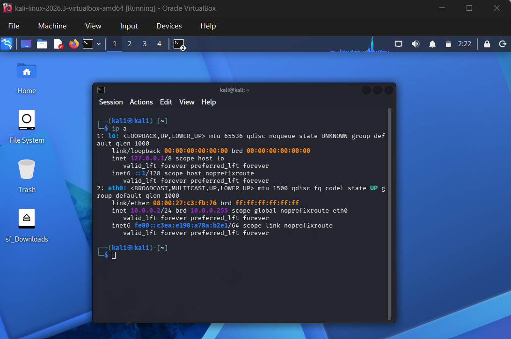
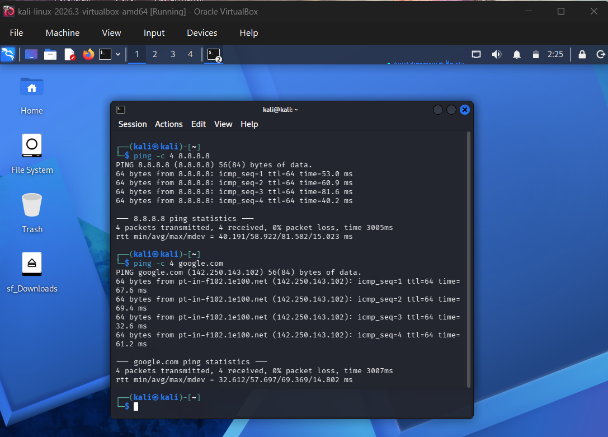
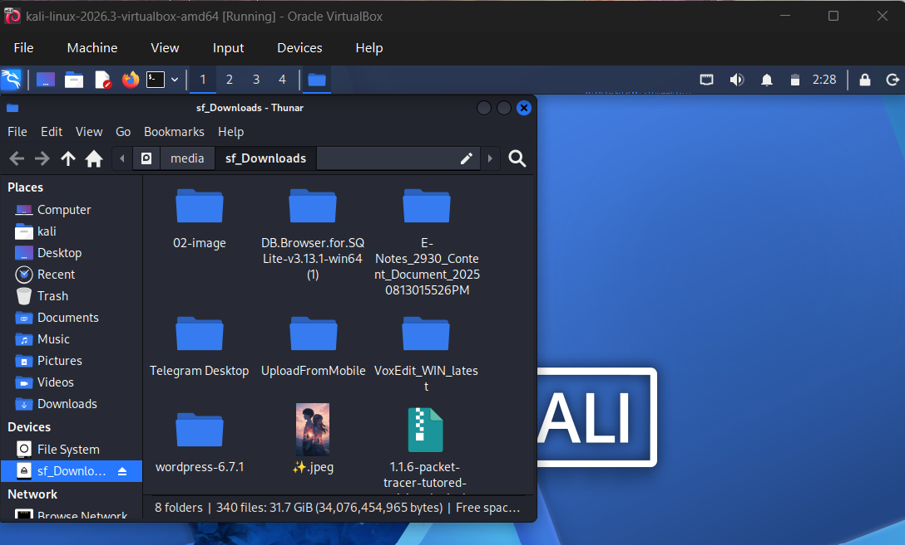
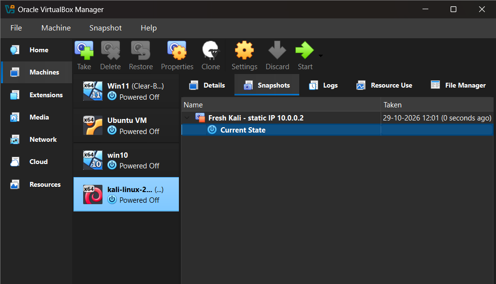

# Cybersecurity Lab Setup: VirtualBox + Kali Linux

Week 1, Project Module 1 (WK1-PM1). A cybersecurity testing lab built with VirtualBox, with Kali Linux 2026.3 as the attacker machine.

## Requirements completed
- VirtualBox as the base
- Kali Linux set up as the attacker machine
- NAT Network `NatNetwork` on 10.0.0.0/24
- Clipboard and drag/drop enabled (bidirectional)
- Host Downloads folder shared into Kali
- Kali static IP 10.0.0.2/24
- Full internet access
- Snapshot taken

## Repository structure
| Folder | Contents |
|---|---|
| `network/` | IP plan and NAT network settings |
| `scripts/` | `set_static_ip.sh`, `fix_internet.sh` |
| `snapshots/` | Snapshot log |
| `screenshots/` | Proof of each step |

## Network
| Item | Value |
|---|---|
| Network | NatNetwork 10.0.0.0/24 |
| Kali IP | 10.0.0.2/24 |
| Gateway | 10.0.0.1 |
| DNS | 8.8.8.8 |

## Step-by-step proof

### 1. VirtualBox installed

### 2. Kali imported

### 3. NAT Network created

### 4. Kali attached to the NAT Network

### 5. Clipboard and drag/drop

### 6. Shared folder

### 7. Kali started

### 8. Static IP configured

### 9. Internet test

### 10. Shared folder inside Kali

### 11. Snapshot

## Notes
Large files (the Kali .vdi, .7z, and installers) are kept off GitHub because of the 100 MB file limit.
